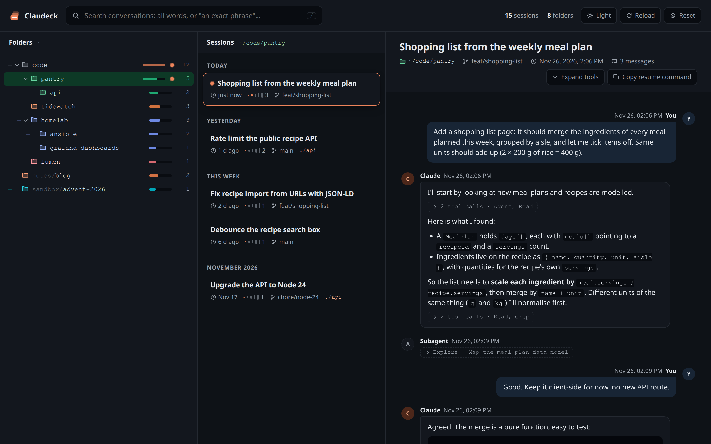
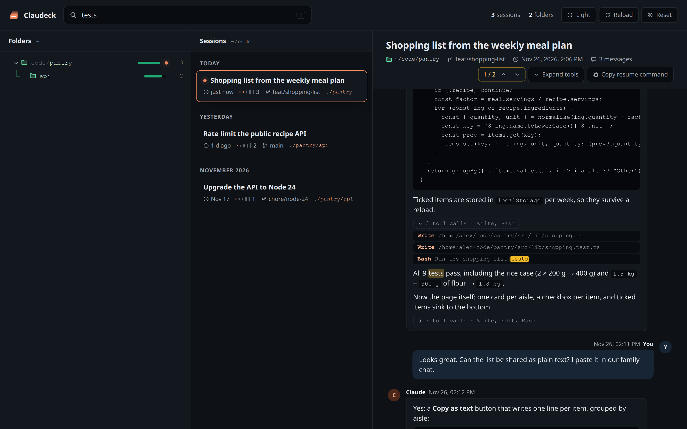

# Claudeck

*Your Claude Code sessions, as a deck you can flip through.*

A read-only web view of your [Claude Code](https://code.claude.com/docs) sessions, organized as a tree of the folders you worked in.

- Find where you talked about something, in your messages or in Claude's replies
- Browse sessions by folder, most recent first, and see which ones are still running
- Read transcripts with tool calls folded away
- Copy the `claude --resume` command for any session



It only reads `~/.claude/projects` and never writes to it. It is one Python script and one HTML page, with no dependencies to install.

## Quick start

You need Python 3.9 or newer, on Linux or macOS.

```bash
git clone https://github.com/pfrayer/claudeck.git
./claudeck/src/claudeck
```

Your browser opens http://localhost:8765/. Stop it with `Ctrl+C`. Use `--port 9000` to pick another port, and `--no-browser` to skip opening a tab. If you moved your Claude Code folder with `CLAUDE_CONFIG_DIR`, claudeck follows it.

## Search

Type words to find the sessions that contain all of them, in any order. Put `"quotes"` around an exact phrase. Case is ignored.

| Query | Finds sessions containing |
| --- | --- |
| `uvicorn root` | both `uvicorn` and `root`, anywhere |
| `"root path" uvicorn` | the phrase `root path`, and `uvicorn` |

Search covers everything you see in a transcript, plus folder names, titles and branches. Matches are highlighted in the open session.



| Key | Action |
| --- | --- |
| `/` | Focus search |
| `Esc` | Clear search |
| `Enter` / `Shift+Enter` | Next / previous match |

## Run it as a service (Linux, systemd)

To keep claudeck always running at http://localhost:8765/, install it as a systemd user service. Here is the unit, [`config/claudeck.service`](config/claudeck.service):

```ini
[Service]
Environment=CLAUDECK_PORT=8765
EnvironmentFile=-%h/.config/claudeck/env
ExecStart=%h/.local/bin/claudeck --no-browser
Restart=on-failure
```

From the repository folder:

```bash
mkdir -p ~/.local/bin ~/.config/systemd/user ~/.config/claudeck
ln -s "$PWD/src/claudeck" ~/.local/bin/claudeck
cp config/claudeck.service ~/.config/systemd/user/
cp config/env.example ~/.config/claudeck/env      # your settings
systemctl --user daemon-reload
systemctl --user enable --now claudeck
```

Settings go in `~/.config/claudeck/env`. Restart with `systemctl --user restart claudeck` after changing them, and read the logs with `journalctl --user -u claudeck`.

[`scripts/install.sh`](scripts/install.sh) does the same steps for you. On macOS, it only adds the `claudeck` command. [`scripts/uninstall.sh`](scripts/uninstall.sh) removes the service and the command, and keeps your settings.

## Update

```bash
git pull
systemctl --user restart claudeck   # if you run it as a service
```

## Remote access

By default claudeck only listens on `127.0.0.1`. To open it from another machine, for example a dev server behind a reverse proxy, listen on all interfaces:

```bash
claudeck --bind 0.0.0.0
```

claudeck then generates a random token and prints the links to open:

```
claudeck listening on 0.0.0.0:8765 (token required, Ctrl+C to stop)
Open one of (the token is then kept in a cookie):
  http://devserver.example.com:8765/?token=0S78rxSEUeECZOLknAFsK2LE_7pmiTjg
```

Open one once, or the same `/?token=…` path on your proxy's address. The browser keeps the token in a cookie, so later visits need nothing. Scripts can send `Authorization: Bearer <token>` instead.

| Flag | Variable | Default | Effect |
| --- | --- | --- | --- |
| `--bind ADDR` | `CLAUDECK_BIND` | `127.0.0.1` | Address to listen on |
| `--token T` | `CLAUDECK_TOKEN` | random at each start | Fixed token, at least 16 characters of `[A-Za-z0-9_-]` |
| `--allowed-host H[,H]` | `CLAUDECK_ALLOWED_HOSTS` | any | Only accept these host names (and `localhost`) |
| `--port N` | `CLAUDECK_PORT` | `8765` | Port, 1024 to 65535 |

Good to know:

- Every request needs the token, even from `localhost`. To create one, run `python3 -c "import secrets; print(secrets.token_urlsafe(24))"`.
- With the service, put `CLAUDECK_BIND` and `CLAUDECK_TOKEN` in `~/.config/claudeck/env`, and run `chmod 600` on that file.
- The proxy must serve claudeck at the root of a host. A sub-path like `/claudeck/` does not work.

## Privacy

Transcripts can contain anything Claude read or printed, secrets included. claudeck keeps them on your machine and sends nothing anywhere. If you expose it, treat the token like a password.

## Tip: keep older sessions

Claude Code deletes sessions after 30 days without activity, so claudeck can no longer show them. To keep them longer, set [`cleanupPeriodDays`](https://code.claude.com/docs/en/settings) in `~/.claude/settings.json`, for example to `3650`.

## License

[MIT](LICENSE). claudeck is an independent project, not affiliated with or endorsed by Anthropic.
